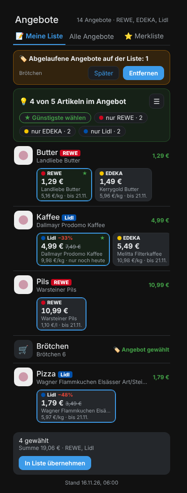
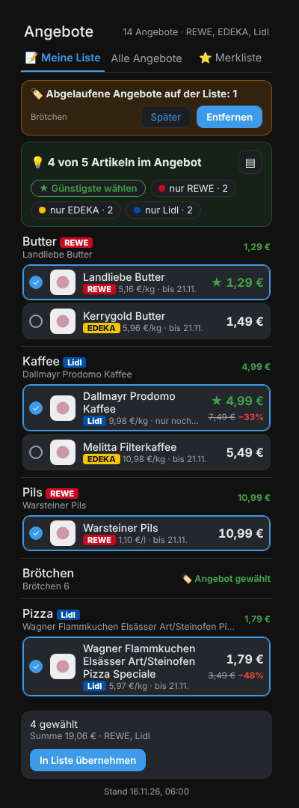
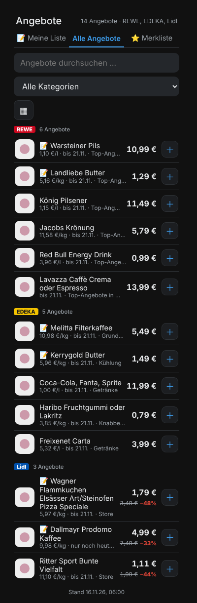
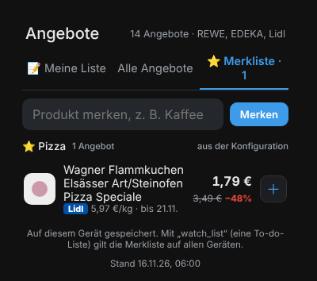

# SmartDiscounts Card

[](https://github.com/m3m0rex/ha_smartlists/releases) [](https://hacs.xyz/) [](https://github.com/m3m0rex/ha_smartlists/blob/main/LICENSE)

[English](README.md) · **Deutsch**

Eine Dashboard-Karte für Home Assistant, die **Supermarkt-Angebote mit deiner Einkaufsliste abgleicht**.

- **Meine Liste:** zu jedem offenen Artikel einer To-do-Liste die passenden Angebote je Markt, das günstigste mit ★.
  „Günstigste wählen“ oder „nur REWE“ wählt für die ganze Liste; „In Liste übernehmen“ schreibt Markt, Preis und
  Gültigkeit an die Einträge.
- **Alle Angebote:** ein Regal je Markt mit Suche und Kategorie-Filter – als Kacheln oder als kompakte Liste mit
  kleinen Bildern; „＋ Auf die Liste“ fügt ein Angebot hinzu.
- **Breite Karten** (ab 720 px) zeigen eine Tabelle Artikel × Märkte.
- **Abgelaufene Angebote** auf der Liste werden angezeigt und lassen sich auf einmal entfernen.
- **Merkliste:** Produkte, bei denen du auf ein Angebot wartest – auf Wunsch mit Benachrichtigung in Home Assistant.
- **Sechs Sprachen:** Deutsch, Englisch, Französisch, Spanisch, Italienisch, Polnisch – nach der Sprache von Home Assistant.
- Läuft **eigenständig** – nötig sind nur Angebots-Sensoren und (optional) eine To-do-Liste. Mit
  [SmartLists](https://github.com/m3m0rex/ha_smartlists) erscheint das gewählte Angebot als Badge am Artikel.

> Dieses Repository wird bei jedem Release automatisch aus [ha_smartlists](https://github.com/m3m0rex/ha_smartlists)
> befüllt. Fehler und Wünsche bitte dort melden.

## So sieht es aus

| Meine Liste: Preise nebeneinander | Meine Liste: ein Angebot je Zeile | Alle Angebote als Liste | Merkliste |
|---|---|---|---|
|  |  |  |  |

Aufnahmen der Karte mit Beispieldaten aus drei Quellen (REWE, EDEKA, Lidl); die Produktbilder sind Platzhalter.

## Installation

**HACS:** `https://github.com/m3m0rex/ha_smartdiscounts-card` als benutzerdefiniertes Repository hinzufügen
(Typ *Dashboard*), „SmartDiscounts Card“ installieren und den Browser neu laden.

Voraussetzung: Home Assistant 2024.9 oder neuer.

**Manuell:** `dist/ha_smartdiscounts-card.js` nach `config/www/` kopieren und `/local/ha_smartdiscounts-card.js`
als Dashboard-Ressource (JavaScript-Modul) eintragen.

Ist SmartLists 4.0 oder neuer installiert, ist die Karte schon dabei – keine eigene Installation nötig.

## Konfiguration

```yaml
type: custom:smartdiscounts-card
list: todo.einkauf        # optional: irgendeine To-do-Liste von Home Assistant
```

| Option | Standard | Bedeutung |
|---|---|---|
| `list` | – | To-do-Liste, mit der die Angebote abgeglichen werden |
| `title` | „Angebote“ | Überschrift |
| `sources` | `auto` | `auto` oder eine Liste von Quellen (siehe unten) |
| `stores` | – | Nur diese Märkte, z. B. `[REWE]` – im Editor auswählbar (eine Karte je Markt) |
| `entities` | – | Nur diese Angebots-Sensoren – im Editor auswählbar |
| `add_to` | – | In diese Liste hinzufügen, z. B. die eigene Quell-Liste einer kombinierten Liste (leer = `list`) |
| `mine_only` | `false` | Kombinierte SmartLists-Liste: nur Artikel aus Listen berücksichtigen, die zum angemeldeten Benutzer gehören |
| `tile_flow` | `grid` | Kacheln untereinander im Raster (`grid`) oder in einer Zeile zum Wischen (`scroll`) |
| `show_list_tab` | `true` | Reiter „Meine Liste“ anzeigen |
| `group_by` | `store` | „Alle Angebote“ nach `store` (Markt) oder `category` (Kategorie) einsortieren; 🗂️ in der Karte schaltet um |
| `categories_open` | `true` | Kategorien ausgeklappt; `false` = zugeklappt starten |
| `category_source` | `auto` | `auto`: Kategorien von SmartLists, sonst vom Markt · `store`: immer die des Markts |
| `match` | `word` | `word` (Butter ≠ Butterkeks), `exact`, `part` |
| `default_tab` | `list` | `list`, `all` oder `watch` |
| `show_images` | `true` | Produktbilder |
| `compact` | `false` | kompakte Zeilen |
| `show_unit_price` | `true` | Grundpreis (€/kg, €/l) |
| `show_valid_until` | `true` | „bis 21.11.“ |
| `hide_without_offer` | `false` | Artikel ohne Angebot ausblenden |
| `list_view` | `chips` | „Meine Liste“: `chips` (Preise nebeneinander; auf breiten Karten eine Tabelle) oder `rows` (ein Angebot je Zeile mit kleinem Bild). ☰ in der Karte schaltet um. |
| `all_view` | `tiles` | „Alle Angebote“ als `tiles` (Kacheln) oder `list` (Liste mit kleinen Bildern); ☰ in der Karte schaltet um, je Gerät gemerkt |
| `max_per_store` | `10` | Angebote je Markt, bevor „alle →“ erscheint |
| `currency` | `EUR` | ISO-Code der Währung |
| `currency_symbol` | – | Eigenes Symbol statt `currency`, z. B. `₺` – steht hinter dem Betrag |
| `watch` | – | Merkliste: Liste von Produkten, z. B. `[Kaffee, Nutella]` |
| `watch_list` | – | Merkliste als To-do-Liste – gilt auf allen Geräten, in der Karte bearbeitbar |
| `notify` | `false` | Benachrichtigung in Home Assistant, wenn etwas von der Merkliste neu im Angebot ist |
| `notify_targets` | – | Zusätzlich an diese Ziele senden – im Editor auswählbar, z. B. `[notify.mobile_app_pixel]` (mehrere möglich) |

### Alle Optionen in einer Konfiguration

Alle Optionen mit ihren Standardwerten – kopieren und löschen, was du nicht brauchst:

```yaml
type: custom:smartdiscounts-card
title: Angebote               # Überschrift (Standard: „Angebote“ in deiner Sprache)
list: todo.einkauf            # To-do-Liste zum Abgleichen (optional)
sources: auto                 # "auto" oder eine Liste, siehe „Quellen“
match: word                   # word | exact | part
default_tab: list             # list | all | watch
list_view: chips              # chips | rows
all_view: tiles               # tiles | list
show_images: true             # Produktbilder
compact: false                # kompakte Zeilen
show_unit_price: true         # Grundpreis (€/kg, €/l)
show_valid_until: true        # „bis 21.11.“
hide_without_offer: false     # Artikel ohne Angebot ausblenden
max_per_store: 10             # Angebote je Markt, bevor „alle →“ erscheint
currency: EUR                 # ISO-Code der Währung
currency_symbol: "₺"          # eigenes Symbol statt currency (optional)
watch:                        # Merkliste: feste Produkte (optional)
  - Kaffee
  - Nutella
watch_list: todo.merkliste    # Merkliste als To-do-Liste (optional)
notify: false                 # benachrichtigen bei neuem Angebot für die Merkliste
notify_targets:               # zusätzlich aufs Smartphone (optional)
  - notify.mobile_app_pixel
```

### Beispiele

**Kleinste Konfiguration** – nur die Angebote zeigen, ohne Liste:

```yaml
type: custom:smartdiscounts-card
```

**Mit einer Einkaufsliste abgleichen** (der häufigste Fall):

```yaml
type: custom:smartdiscounts-card
list: todo.einkauf
```

**Smartphone: alles als kompakte Listen mit kleinen Bildern:**

```yaml
type: custom:smartdiscounts-card
list: todo.einkauf
list_view: rows
all_view: list
compact: true
```

**Nur Text, keine Bilder** (spart mobile Daten):

```yaml
type: custom:smartdiscounts-card
list: todo.einkauf
show_images: false
list_view: rows
all_view: list
```

**Prospekt auf dem Wand-Tablet** – mit allen Angeboten starten, mehr je Markt zeigen:

```yaml
type: custom:smartdiscounts-card
title: Angebote der Woche
default_tab: all
all_view: tiles
max_per_store: 30
```

**Nur, was im Angebot ist** – Artikel ohne Treffer ausblenden, genau abgleichen:

```yaml
type: custom:smartdiscounts-card
list: todo.einkauf
hide_without_offer: true
match: exact
```

**Nur bestimmte Märkte** – die Sensoren nennen statt `auto`:

```yaml
type: custom:smartdiscounts-card
list: todo.einkauf
sources:
  - sensor.rewe_123456
  - entity: sensor.lidl_offers
    store: Lidl
```

**Eigener Sensor zusätzlich zu den erkannten** (alle Felder von `map:` stehen unter „Quellen“):

```yaml
type: custom:smartdiscounts-card
list: todo.einkauf
sources:
  - auto
  - entity: sensor.mein_markt
    attribute: results
    store: Kaufland
    color: "#e10915"
    map:
      name: product.name
      price: prices.current
      old_price: prices.regular
      until: validity.to
```

**Eine Karte nur für REWE, nach Kategorie einsortiert:**

```yaml
type: custom:smartdiscounts-card
title: REWE
list: todo.einkauf
stores:
  - REWE
default_tab: all
group_by: category
categories_open: false
```

**Schweizer Franken:**

```yaml
type: custom:smartdiscounts-card
list: todo.einkauf
currency: CHF
```

**Merkliste mit Benachrichtigung aufs Smartphone:**

```yaml
type: custom:smartdiscounts-card
list: todo.einkauf
default_tab: watch
watch_list: todo.merkliste
notify: true
notify_targets:
  - notify.mobile_app_pixel
```

**Eigenes Währungssymbol** (für Währungen ohne passenden ISO-Code):

```yaml
type: custom:smartdiscounts-card
list: todo.einkauf
currency_symbol: "₺"
```

**Breites Dashboard-Feld** – mit `list_view: chips` zeigt eine Karte ab 720 px die Tabelle Artikel × Märkte:

```yaml
type: custom:smartdiscounts-card
list: todo.einkauf
list_view: chips
grid_options:
  columns: full
```

## Quellen

Mit `sources: auto` wird jeder Sensor verwendet, der in einem der Attribute `discounts`, `offers`, `deals`, `items`,
`results` oder `products` eine Liste von Angeboten hat. Das deckt die Integrationen
[ha-rewe](https://github.com/FaserF/ha-rewe), [ha-edeka](https://github.com/FaserF/ha-edeka),
[ha-lidl](https://github.com/FaserF/ha-lidl), [ha-aldi](https://github.com/FaserF/ha-aldi) und
[ha-norma](https://github.com/FaserF/ha-norma) ab – und deine eigenen REST- oder Template-Sensoren.

Die Feldnamen werden automatisch erkannt:

| Feld in `map:` | Bedeutung | Automatisch erkannt als |
|---|---|---|
| `name` | Produktname (**Pflicht**) | `product`, `title`, `name`, `product_name`, `description` |
| `price` | Angebotspreis (**Pflicht**) | `price`, `new_price`, `discount_price`, `offer_price`, `sale_price`, `price_euro`, `current_price` |
| `old_price` | alter Preis, durchgestrichen angezeigt | `old_price`, `regular_price`, `original_price`, `was_price` |
| `discount` | Rabatt, z. B. „-44%“ (sonst aus altem und neuem Preis berechnet) | `discount`, `discount_percent`, `savings` |
| `unit` | Grundpreis als Text, z. B. „1 kg = 5,16 €“ – damit werden Märkte verglichen | `price_per_unit`, `base_price`, `unit_price` |
| `image` | Adresse des Bildes | `picture_link`, `image_url`, `image`, `picture`, `img`, `thumbnail` |
| `until` | gültig bis (`JJJJ-MM-TT`); abgelaufene Angebote werden ausgeblendet | `valid_until`, `end_date`, `valid_to`, `until` |
| `category` | Kategorie für den Filter | `category`, `categories`, `group` |
| `brand` | Marke (durchsuchbar) | `brand`, `manufacturer` |
| `store` | Markt dieses einen Angebots (für Sensoren, die mehrere Märkte mischen) | `store`, `market`, `retailer`, `advertiser` |

Diese zehn Felder sind alles, was die Karte aus einem Angebot liest. Nur `name` und `price` sind Pflicht – was
fehlt, wird einfach nicht angezeigt.

Preise dürfen Zahlen oder Text sein („11,49 €“, „1.11 €“). Abgelaufene Angebote werden ausgeblendet.

### Eigene Sensoren und Feld-Zuordnung

Ein Punkt greift in verschachtelte Daten (`product.name`), eine Zahl wählt einen Eintrag einer Liste (`images.0.url`).

```yaml
type: custom:smartdiscounts-card
list: todo.einkauf
sources:
  - auto                              # automatische Erkennung behalten
  - entity: sensor.mein_markt         # eigener Sensor
    store: Kaufland                   # Name auf dem Badge (Standard: aus dem Namen der Entität)
    color: "#e10915"                  # Farbe des Badges (optional)
    attribute: results                # Attribut mit der Liste (Standard: wird erkannt)
    map:                              # links das Feld der Karte, rechts das Feld deines Sensors
      name: product.name              # Produktname (Pflicht)
      price: prices.current           # Angebotspreis (Pflicht) – Zahl oder Text wie „1,29 €“
      old_price: prices.regular       # alter Preis
      discount: discount              # z. B. „-44%“
      unit: unitPriceText             # z. B. „1 kg = 5,16 €“
      image: images.0.url             # Adresse des Bildes
      until: validity.to              # gültig bis, JJJJ-MM-TT
      category: category              # Kategorie
      brand: brand                    # Marke
      store: retailer.name            # Markt je Angebot (statt `store:` oben)
```

Der Markt kommt aus `store:`, aus einem Feld `store` des Angebots oder aus dem Namen der Entität
(REWE, EDEKA, Lidl, ALDI, Norma, Penny, Kaufland, Netto, dm, Rossmann und Globus werden erkannt).

## Merkliste und Benachrichtigungen

Im Reiter **⭐ Merkliste** stehen Produkte, bei denen du auf ein Angebot wartest. Zu jedem siehst du die aktuellen
Angebote; die Zahl am Reiter zeigt, wie viele gemerkte Produkte gerade im Angebot sind.

Woher die Merkliste kommt:

- `watch:` – feste Produkte in der Konfiguration.
- `watch_list:` – eine To-do-Liste von Home Assistant. Sie gilt auf allen Geräten und lässt sich in der Karte
  ergänzen und kürzen.
- **Mit SmartLists** (ab 4.0.0-beta.2) nutzt die Karte ohne `watch_list` die Merkliste des Haushalts: Sie gilt auf allen
  Geräten, und Home Assistant meldet neue Angebote auch ohne geöffnetes Dashboard (Einstellungen → Preise & Währung).
- Ohne SmartLists und ohne `watch_list` speichert die Karte, was du im Reiter einträgst, **nur auf diesem Gerät**.

Mit `notify: true` legt die Karte eine Benachrichtigung in Home Assistant an, sobald ein gemerktes Produkt neu im
Angebot ist; `notify_targets` schickt sie zusätzlich z. B. aufs Smartphone. Jedes Angebot wird je Gerät nur einmal
gemeldet.

> **Wichtig:** Die Prüfung läuft in der Karte. Gemeldet wird also, wenn ein Dashboard mit der Karte geöffnet ist
> (z. B. auf einem Wand-Tablet). Soll Home Assistant auch ohne offenes Dashboard melden, nimm eine Automation:

```yaml
automation:
  - alias: Kaffee im Angebot
    triggers:
      - trigger: state
        entity_id: sensor.rewe_123456
    conditions:
      - condition: template
        value_template: >
          {{ state_attr('sensor.rewe_123456', 'discounts') | default([], true)
             | selectattr('product', 'search', 'kaffee', ignorecase=true) | list | count > 0 }}
    actions:
      - action: notify.mobile_app_pixel
        data:
          title: Kaffee im Angebot
          message: >
            {{ state_attr('sensor.rewe_123456', 'discounts')
               | selectattr('product', 'search', 'kaffee', ignorecase=true)
               | map(attribute='product') | join(', ') }}
```

## Abgelaufene Angebote

Ist ein Angebot abgelaufen, das du in die Liste übernommen hast, zeigt die Karte über „Meine Liste“ einen Hinweis
mit **Entfernen** und **Später**. „Entfernen“ nimmt Markt, Preis und Gültigkeit von den Einträgen – die Einträge
selbst und ihre Notizen bleiben.

## So funktioniert „In Liste übernehmen“

- **Mit SmartLists:** Das Angebot wird an den Artikel gehängt und dort als Badge mit Markt, Preis und Gültigkeit
  gezeigt.
- **Ohne SmartLists:** In die Beschreibung des To-do-Eintrags kommt eine lesbare Zeile,
  z. B. `🏷️ REWE · 1,29 € · bis 21.11.2026 · Landliebe Butter`.

## Lizenz

MIT
