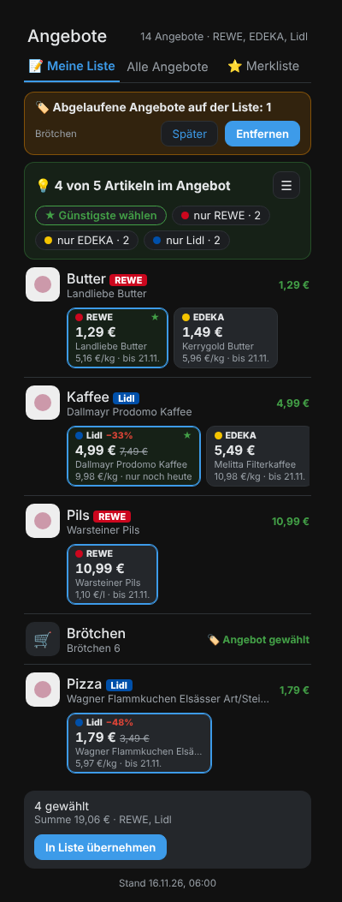
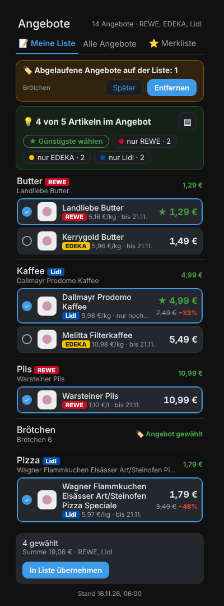
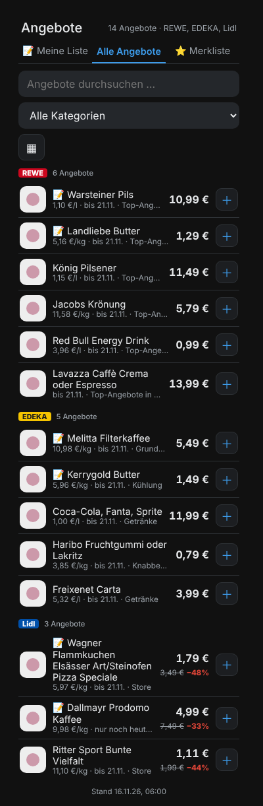
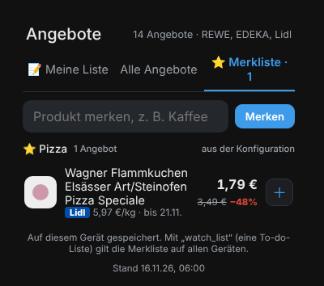

# SmartDiscounts Card

[](https://github.com/m3m0rex/ha_smartlists/releases) [](https://hacs.xyz/) [](https://github.com/m3m0rex/ha_smartlists/blob/main/LICENSE)

**English** · [Deutsch](README.de.md)

A Home Assistant dashboard card that shows **supermarket offers matched with your shopping list**.

- **My list:** for every open item of a to-do list the matching offers per store, the cheapest marked ★.
  "Pick cheapest" or "only REWE" selects for the whole list; "Apply to list" writes store, price and validity
  to the items.
- **All offers:** one shelf per store with search and category filter – as tiles or as a compact list with
  small images; "＋ Add to list" adds an offer.
- **Wide cards** (≥ 720 px) show a table of items × stores.
- **Expired offers** on the list are pointed out and can be removed in one go.
- **Watch list:** products you are waiting to see on offer – with a Home Assistant notification if you like.
- **Six languages:** German, English, French, Spanish, Italian, Polish – following the language of Home Assistant.
- Works **on its own** – it only needs offer sensors and (optionally) a to-do list. With
  [SmartLists](https://github.com/m3m0rex/ha_smartlists) the selected offer appears as a badge on the item.

> This repository is synced automatically from [ha_smartlists](https://github.com/m3m0rex/ha_smartlists)
> with every release. Please open issues and pull requests there.

## Screenshots

| My list: prices side by side | My list: one offer per row | All offers as a list | Watch list |
|---|---|---|---|
|  |  |  |  |

The card with sample data from three sources (REWE, EDEKA, Lidl); the product images are placeholders.

## Installation

**HACS:** add `https://github.com/m3m0rex/ha_smartdiscounts-card` as a custom repository (type *Dashboard*),
install "SmartDiscounts Card" and reload the browser.

Requires Home Assistant 2024.9 or newer.

**Manual:** copy `dist/ha_smartdiscounts-card.js` to `config/www/` and add `/local/ha_smartdiscounts-card.js`
as a dashboard resource (JavaScript module).

If SmartLists 4.0 or newer is installed, the card is already included – no separate installation needed.

## Configuration

```yaml
type: custom:smartdiscounts-card
list: todo.shopping        # optional: any Home Assistant to-do list
```

| Option | Default | Description |
|---|---|---|
| `list` | – | To-do list to match offers against |
| `title` | "Offers" | Heading |
| `sources` | `auto` | `auto`, or a list of sources (see below) |
| `stores` | – | Only these stores, e.g. `[REWE]` – selectable in the editor (one card per store) |
| `entities` | – | Only these offer sensors – selectable in the editor |
| `add_to` | – | Add to this list, e.g. your own source list of a combined list (empty = `list`) |
| `mine_only` | `false` | Combined SmartLists list: only consider items from lists that belong to the signed-in user |
| `tile_flow` | `grid` | Tiles top to bottom in a grid (`grid`) or in one row to swipe (`scroll`) |
| `tabs` | `[list, all, watch]` | Which tabs in which order – e.g. `[all, watch]`; with only one tab the bar disappears |
| `group_by` | `store` | Group "All offers" by `store` or by `category`; 🗂️ in the card switches |
| `categories_open` | `true` | Categories expanded; `false` = start folded |
| `category_source` | `auto` | `auto`: categories from SmartLists, otherwise from the store · `store`: always the store's own |
| `match` | `word` | `word` (butter ≠ butter biscuit), `exact`, `part` |
| `default_tab` | `list` | `list`, `all` or `watch` |
| `show_images` | `true` | Product images |
| `compact` | `false` | Compact rows |
| `show_unit_price` | `true` | Unit price (€/kg, €/l) |
| `show_valid_until` | `true` | "until 21.11." |
| `hide_without_offer` | `false` | Hide list items without an offer |
| `list_view` | `chips` | "My list": `chips` (prices side by side; a table on wide cards), `rows` (one offer per row), `compact` (one line per item) or `table` (stores as columns). The buttons in the card switch. |
| `all_view` | `tiles` | "All offers" as `tiles` or as a `list` with small images (☰ in the card switches, remembered per device) |
| `max_per_store` | `10` | Offers per store before "all →" |
| `currency` | `EUR` | ISO currency code for prices |
| `currency_symbol` | – | Own symbol instead of `currency`, e.g. `₺` – shown after the amount |
| `watch` | – | Watch list: a list of products, e.g. `[coffee, Nutella]` |
| `watch_list` | – | Watch list as a to-do list – the same on all devices, editable in the card |
| `notify` | `false` | Home Assistant notification when something on the watch list is newly on offer |
| `notify_targets` | – | Also send to these targets – selectable in the editor, e.g. `[notify.mobile_app_pixel]` (several possible) |

### Every option in one configuration

All options with their default values – copy it and delete what you don't need:

```yaml
type: custom:smartdiscounts-card
title: Offers                 # heading (default: "Offers" in your language)
list: todo.shopping           # to-do list to match against (optional)
sources: auto                 # "auto" or a list, see "Sources"
match: word                   # word | exact | part
default_tab: list             # list | all | watch
list_view: chips              # chips | rows | compact | table
all_view: tiles               # tiles | list
show_images: true             # product images
compact: false                # compact rows
show_unit_price: true         # unit price (€/kg, €/l)
show_valid_until: true        # "until 21.11."
hide_without_offer: false     # hide list items without an offer
max_per_store: 10             # offers per store before "all →"
currency: EUR                 # ISO code for prices
currency_symbol: "₺"          # own symbol instead of currency (optional)
watch:                        # watch list: fixed products (optional)
  - coffee
  - Nutella
watch_list: todo.watchlist    # watch list as a to-do list (optional)
notify: false                 # notify when a watched product is newly on offer
notify_targets:               # also send to the phone (optional)
  - notify.mobile_app_pixel
```

### Examples

**Smallest configuration** – only show the offers, no list:

```yaml
type: custom:smartdiscounts-card
```

**Matched with a shopping list** (most common):

```yaml
type: custom:smartdiscounts-card
list: todo.shopping
```

**Phone: everything as compact lists with small images:**

```yaml
type: custom:smartdiscounts-card
list: todo.shopping
list_view: rows
all_view: list
compact: true
```

**Text only, no images** (saves mobile data):

```yaml
type: custom:smartdiscounts-card
list: todo.shopping
show_images: false
list_view: rows
all_view: list
```

**Flyer on a wall tablet** – start with all offers, show more per store:

```yaml
type: custom:smartdiscounts-card
title: This week's offers
default_tab: all
all_view: tiles
max_per_store: 30
```

**Only what is on offer** – hide list items without a match, strict matching:

```yaml
type: custom:smartdiscounts-card
list: todo.shopping
hide_without_offer: true
match: exact
```

**Only selected stores** – name the sensors instead of `auto`:

```yaml
type: custom:smartdiscounts-card
list: todo.shopping
sources:
  - sensor.rewe_123456
  - entity: sensor.lidl_offers
    store: Lidl
```

**Own sensor in addition to the detected ones** (all `map:` fields are listed under "Sources"):

```yaml
type: custom:smartdiscounts-card
list: todo.shopping
sources:
  - auto
  - entity: sensor.my_market
    attribute: results
    store: Kaufland
    color: "#e10915"
    map:
      name: product.name
      price: prices.current
      old_price: prices.regular
      until: validity.to
```

**A card only for REWE, grouped by category:**

```yaml
type: custom:smartdiscounts-card
title: REWE
list: todo.shopping
stores:
  - REWE
default_tab: all
group_by: category
categories_open: false
```

**Swiss francs:**

```yaml
type: custom:smartdiscounts-card
list: todo.einkauf
currency: CHF
```

**Watch list with a notification on the phone:**

```yaml
type: custom:smartdiscounts-card
list: todo.shopping
default_tab: watch
watch_list: todo.watchlist
notify: true
notify_targets:
  - notify.mobile_app_pixel
```

**Own currency symbol** (for currencies without a matching ISO code):

```yaml
type: custom:smartdiscounts-card
list: todo.shopping
currency_symbol: "₺"
```

**Wide dashboard panel** – with `list_view: chips` a card of 720 px or more shows the table of items × stores:

```yaml
type: custom:smartdiscounts-card
list: todo.shopping
list_view: chips
grid_options:
  columns: full
```

## Sources

With `sources: auto` every sensor is used that has a list of offers in one of the attributes
`discounts`, `offers`, `deals`, `items`, `results` or `products`. This covers the integrations by [FaserF](https://github.com/FaserF) –
[ha-rewe](https://github.com/FaserF/ha-rewe), [ha-edeka](https://github.com/FaserF/ha-edeka), [ha-lidl](https://github.com/FaserF/ha-lidl), [ha-aldi](https://github.com/FaserF/ha-aldi), [ha-norma](https://github.com/FaserF/ha-norma) –
and your own REST or template sensors.

Field names are recognised automatically:

| `map:` key | Meaning | Recognised automatically |
|---|---|---|
| `name` | Product name (**required**) | `product`, `title`, `name`, `product_name`, `description` |
| `price` | Offer price (**required**) | `price`, `new_price`, `discount_price`, `offer_price`, `sale_price`, `price_euro`, `current_price` |
| `old_price` | Regular price, shown struck through | `old_price`, `regular_price`, `original_price`, `was_price` |
| `discount` | Discount, e.g. "-44%" (otherwise calculated from old and new price) | `discount`, `discount_percent`, `savings` |
| `unit` | Unit price text, e.g. "1 kg = 5,16 €" – used to compare stores | `price_per_unit`, `base_price`, `unit_price` |
| `image` | Image URL | `picture_link`, `image_url`, `image`, `picture`, `img`, `thumbnail` |
| `until` | Valid until (`YYYY-MM-DD`); expired offers are hidden | `valid_until`, `end_date`, `valid_to`, `until` |
| `category` | Category for the filter | `category`, `categories`, `group` |
| `brand` | Brand (searchable) | `brand`, `manufacturer` |
| `store` | Store of this single offer (for sensors that mix several stores) | `store`, `market`, `retailer`, `advertiser` |

These ten keys are everything the card reads from an offer. Only `name` and `price` are required – anything
missing is simply not shown.

Prices may be numbers or text ("11,49 €", "1.11 €"). Expired offers are hidden.

### Own sensors and field mapping

A dot reaches into nested data (`product.name`), a number picks an entry of a list (`images.0.url`).

```yaml
type: custom:smartdiscounts-card
list: todo.shopping
sources:
  - auto                              # keep the automatic detection
  - entity: sensor.my_market          # own sensor
    store: Kaufland                   # name shown on the badge (default: from the entity name)
    color: "#e10915"                  # badge colour (optional)
    attribute: results                # attribute with the list (default: detected)
    map:                              # left: the card's field, right: the field of your sensor
      name: product.name              # product name (required)
      price: prices.current           # offer price (required) – number or text like "1,29 €"
      old_price: prices.regular       # regular price
      discount: discount              # e.g. "-44%"
      unit: unitPriceText             # e.g. "1 kg = 5,16 €"
      image: images.0.url             # image URL
      until: validity.to              # valid until, YYYY-MM-DD
      category: category              # category
      brand: brand                    # brand
      store: retailer.name            # store per offer (instead of `store:` above)
```

The store is taken from `store:`, a `store` field of the offer, or the entity name
(REWE, EDEKA, Lidl, ALDI, Norma, Penny, Kaufland, Netto, dm, Rossmann and Globus are recognised).

## Watch list and notifications

The **⭐ Watch list** tab holds products you are waiting to see on offer. For each one you see the current offers;
the number on the tab shows how many watched products are on offer right now.

Where the watch list comes from:

- `watch:` – fixed products in the configuration.
- `watch_list:` – a Home Assistant to-do list. It is the same on all devices and can be extended and shortened in
  the card.
- **With SmartLists** (4.0.0-beta.2 or newer) and no `watch_list`, the card uses the household's watch list: it is the
  same on all devices, and Home Assistant reports new offers even with no dashboard open (Settings → Prices & currency).
- Without SmartLists and without `watch_list` the card stores what you enter in the tab **on this device only**.

With `notify: true` the card creates a Home Assistant notification as soon as a watched product is newly on offer;
`notify_targets` also sends it e.g. to your phone. Every offer is reported once per device.

> **Important:** the check runs in the card. It reports while a dashboard with the card is open (e.g. on a wall
> tablet). If Home Assistant should notify without an open dashboard, use an automation:

```yaml
automation:
  - alias: Coffee on offer
    triggers:
      - trigger: state
        entity_id: sensor.rewe_123456
    conditions:
      - condition: template
        value_template: >
          {{ state_attr('sensor.rewe_123456', 'discounts') | default([], true)
             | selectattr('product', 'search', 'coffee', ignorecase=true) | list | count > 0 }}
    actions:
      - action: notify.mobile_app_pixel
        data:
          title: Coffee on offer
          message: >
            {{ state_attr('sensor.rewe_123456', 'discounts')
               | selectattr('product', 'search', 'coffee', ignorecase=true)
               | map(attribute='product') | join(', ') }}
```

## Expired offers

When an offer you applied to the list has run out, the card shows a note above "My list" with **Remove** and
**Later**. "Remove" takes store, price and validity off the items – the items themselves and their notes stay.

## How "Apply to list" works

- **With SmartLists:** the offer is attached to the item and shown there as a badge with store, price and
  validity. Once it has expired it is marked as such and can be removed (see above).
- **Without SmartLists:** a readable line is written to the description of the to-do item,
  e.g. `🏷️ REWE · 1,29 € · until 21.11.2026 · Landliebe Butter`.

## Thanks to FaserF

The offer data does not come from this card but from the integrations by [FaserF](https://github.com/FaserF) – without them there would be
nothing to show here. Thank you! All his projects: [hassio-addons.fabiseitz.de](https://hassio-addons.fabiseitz.de/)

| | Integration | What it provides |
|---|---|---|
| 🏷️ | [ha-grocery-deals](https://github.com/FaserF/ha-grocery-deals) | Multi-store price comparison: aggregates the store integrations |
| 🔴 | [ha-rewe](https://github.com/FaserF/ha-rewe) | REWE: weekly offers, bonus points and discounts |
| 🟡 | [ha-edeka](https://github.com/FaserF/ha-edeka) | EDEKA: weekly offers, discounts and PAYBACK card |
| 🔵 | [ha-lidl](https://github.com/FaserF/ha-lidl) | Lidl Plus: weekly offers, coupons and digital receipts |
| ⚪ | [ha-aldi](https://github.com/FaserF/ha-aldi) | ALDI Süd and ALDI Nord: weekly flyers |
| 🔴 | [ha-norma](https://github.com/FaserF/ha-norma) | Norma: weekly discounts and flyer offers |
| 🔴 | [ha-penny](https://github.com/FaserF/ha-penny) | PENNY: digital receipts (eBons) and loyalty points |

The card is an independent project and not affiliated with FaserF or the stores mentioned.

## License

MIT
